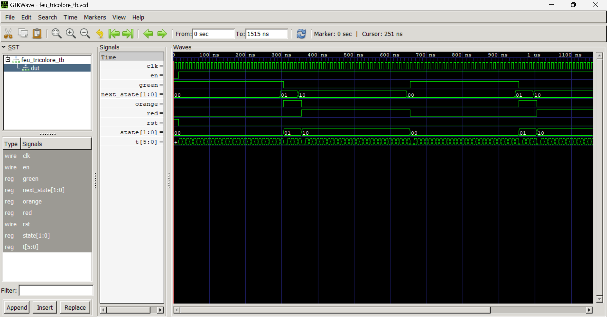

# Projet Title /Titre du projet 

Traffic Light FSM / FSM Feu Tricolore

## Description (EN)

A Finite State Machine (FSM) describes all the possible states 
a system can be in at any given time. These states are finite 
and predefined. A traffic light is a perfect real-world example 
of an FSM — it cycles through 3 states (GREEN, ORANGE, RED) 
with automatic time-based transitions. Given the simplicity of 
this system, a Moore machine was chosen, where outputs depend 
only on the current state.

## Description (FR)

Une machine à états finis (FSM) décrit l'ensemble des états 
que peut prendre un système à un instant donné. Ces états sont 
finis et prédéfinis. Un feu tricolore est un exemple concret 
de FSM — il cycle à travers 3 états (VERT, ORANGE, ROUGE) avec 
des transitions automatiques basées sur le temps. Compte tenu 
de la simplicité du système, le modèle de Moore a été choisi, 
où les sorties dépendent uniquement de l'état courant.

## State Diagram / Diagramme d'états


## Signals / Signaux

| Signal | Direction | Description |
|--------|-----------|-------------|
| clk    |   input   | System clock        |
| rst    |   input   | Asynchronous reset — returns to GREEN state|
| en     |   input   | Enable signal — starts the counter and state transitions|
| red    |   output  | Red light signal    |
| orange |   output  | Orange light signal |
| green  |   output  | Green light signal  |

## How to simulate / Comment simuler
**Compilation :**
```bash
iverilog -g2012 -o feu_tricolore_tb src/feu_tricolore.sv tb/feu_tricolore_tb.sv
```
**Simulation :**
```bash
vvp feu_tricolore_tb
```

## Waveform / Formes d'onde


## Author / Auteur
LIADI Ramadan Atanda