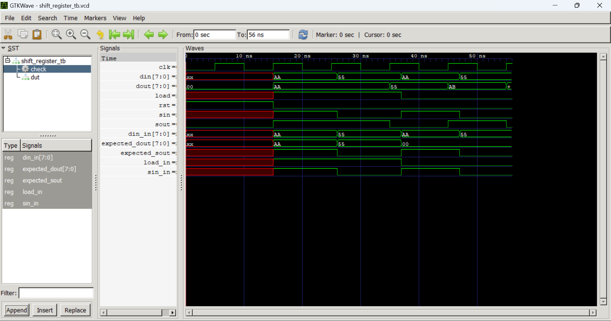

# Titre EN / Titre FR
8-bit shift register
## Description (EN)

A shift register is a sequential circuit that stores and shifts 
data at each clock cycle. This implementation supports two operating 
modes: in serial mode (load=0), data enters one bit at a time through 
the serial input (sin) and shifts left at each clock cycle, while the 
MSB exits through the serial output (sout). In parallel mode (load=1), 
all 8 bits are loaded simultaneously from the parallel input (din). 
Shift registers are widely used in real systems for serial-to-parallel 
and parallel-to-serial data conversion, notably in communication 
protocols such as UART, SPI, and I2C.

## Description (FR)

Un registre à décalage est un circuit séquentiel qui stocke et décale 
des données à chaque cycle d'horloge. Cette implémentation supporte 
deux modes de fonctionnement : en mode série (load=0), les données 
entrent bit par bit par l'entrée série (sin) et se décalent vers la 
gauche à chaque cycle, tandis que le bit de poids fort sort par la 
sortie série (sout). En mode parallèle (load=1), les 8 bits sont 
chargés simultanément depuis l'entrée parallèle (din). Les registres 
à décalage sont largement utilisés pour la conversion série vers 
parallèle et parallèle vers série, notamment dans les protocoles de 
communication tels que UART, SPI et I2C.

## Features / Fonctionnalités

- 8-bit shift register
- Serial input (sin) / Serial output (sout)
- Parallel load (din) / Parallel output (dout)
- Asynchronous reset


## Signals / Signaux

| Signal | Direction | Description |
|--------|-----------|-------------|
| clk    |  input    |    System clock         |
| rst    |  input    |      Asynchronous reset        |
| sin    |  input    |   Serial input|
| load   |  input    |     mode select   |
| din    |  input    |      Parallel load       |
| sout   |  output   |   Serial output  |
| dout   |  output   |    Parallel output|

## Operating Modes / Modes de fonctionnement

| load | Mode | Behaviour |
|------|------|-----------|
| 1    | Parallel load| All 8 bits of din are loaded into the register simultaneously   |
| 0    | Serial shift | Register shifts left by 1 bit, sin enters at LSB, MSB exits on sout |

## How to simulate / Comment simuler

**Compilation :**
```bash
iverilog -g2012 -o shift_register_tb src/shift_register.sv tb/shift_register_tb.sv
```
**Simulation :**
```bash
vvp shift_register_tb
```

## Waveform / Formes d'onde


## Author / Auteur
LIADI Ramadan Atanda