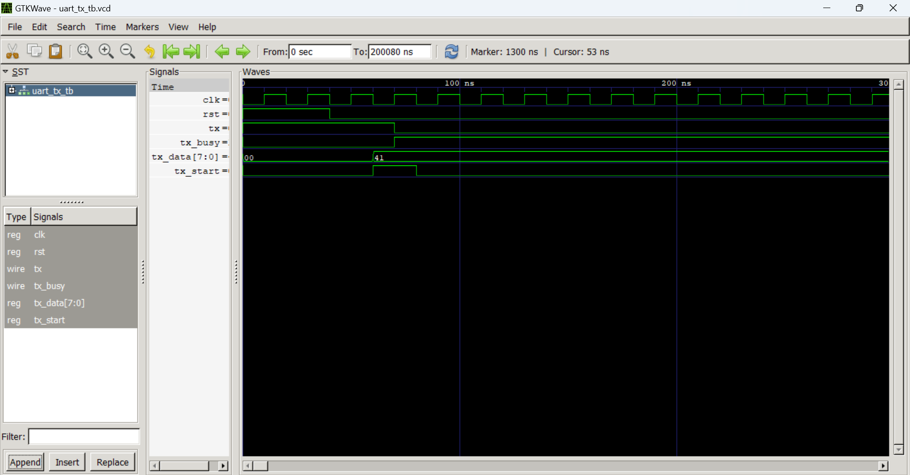
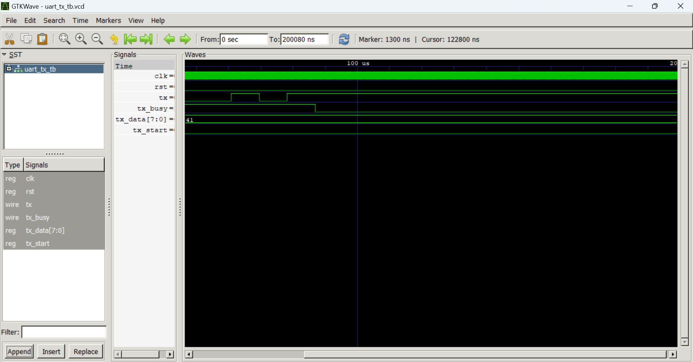
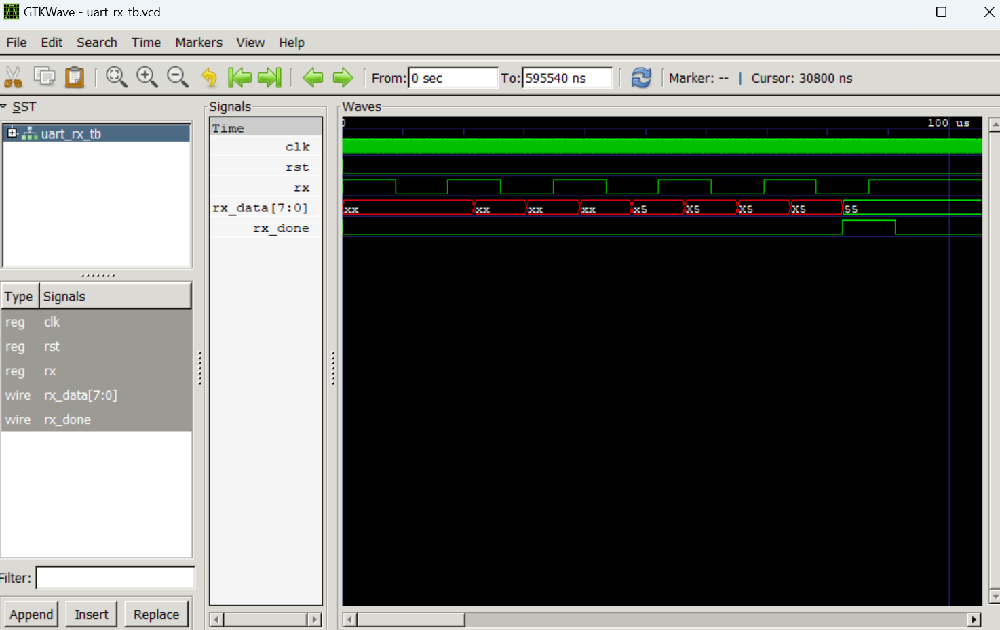

# Projet Title / Titre du projet

UART Transmitter & Receiver / Émetteur & Récepteur UART

## Description (EN)

UART (Universal Asynchronous Receiver Transmitter) is a serial communication protocol. Asynchronous means that the transmitter and receiver do not share the same clock — they must agree in advance on the transmission speed (baud rate). The TX module takes an 8-bit data frame and sends it bit by bit in LSB-first order. The RX module receives the bits one by one and assembles them into an 8-bit data frame. Since the RX does not know exactly when each bit arrives, it samples each bit at the middle of its period (217 cycles out of 434) to ensure a stable read.

## Description (FR)

L'UART (Universal Asynchronous Receiver Transmitter) est un protocole de communication série. Asynchrone signifie que l'émetteur et le récepteur ne partagent pas la même horloge — ils doivent se mettre d'accord à l'avance sur la vitesse de transmission (baud rate). Le module TX prend une trame de 8 bits et l'envoie bit par bit en mode LSB en premier. Le module RX reçoit les bits un par un et les assemble en une trame de 8 bits. Comme le RX ne sait pas exactement quand chaque bit arrive, il échantillonne chaque bit au milieu de sa période (217 cycles sur 434) pour garantir une lecture stable.

## UART Frame / Trame UART

IDLE START D0 D1 D2 D3 D4 D5 D6 D7 STOP
1 0 b0 b1 b2 b3 b4 b5 b6 b7 1

## Parameters / Paramètres

| Parameter | Value | Description |
|-----------|-------|-------------|
| CLK_FREQ | 50 000 000 | Nombre de cycles d'horloge par seconde |
| BAUD_RATE | 115 200 | Nombre de bits par seconde |
| CLKS_PER_BIT | 434 | Nombre de cycles par bit |

## TX Signals / Signaux TX

| Signal | Direction | Description |
|--------|-----------|-------------|
| clk | input | System clock |
| rst | input | Asynchronous reset — returns to IDLE state |
| tx_start | input | Activation signal — starts the transmission |
| tx_data | input | 8-bit data frame to send |
| tx | output | Serial output — bits sent one by one |
| tx_busy | output | Indicates the transmitter is busy |

## RX Signals / Signaux RX

| Signal | Direction | Description |
|--------|-----------|-------------|
| clk | input | System clock |
| rst | input | Asynchronous reset — returns to IDLE state |
| rx | input | Serial input — bits received one by one |
| rx_data | output | 8-bit data frame assembled from received bits |
| rx_done | output | Indicates reception is complete |

## FSM States / États FSM

| State | TX behaviour | RX behaviour |
|-------|-------------|-------------|
| IDLE | Waits for tx_start=1 to go to START | Waits for rx=0 (START bit detection) |
| START | Waits 434 cycles then goes to DATA | Waits 217 cycles (mid-bit alignment) then goes to DATA |
| DATA | Sends bits one by one from tx_data (LSB first) | Samples rx at mid-period, stores bits into rx_data |
| STOP | Sends stop bit (tx=1), waits 434 cycles then goes to IDLE | Waits 434 cycles, sets rx_done=1 then goes to IDLE |

## How to simulate / Comment simuler

**TX Compilation & Simulation :**
```bash
iverilog -g2012 -o uart_tx_tb.vvp src/uart_tx.sv tb/uart_tx_tb.sv
vvp uart_tx_tb.vvp
```

**RX Compilation & Simulation :**
```bash
iverilog -g2012 -o uart_rx_tb.vvp src/uart_rx.sv tb/uart_rx_tb.sv
vvp uart_rx_tb.vvp
```

## Waveform TX / Formes d'onde TX



## Waveform RX / Formes d'onde RX


## Author / Auteur
LIADI Ramadan Atanda