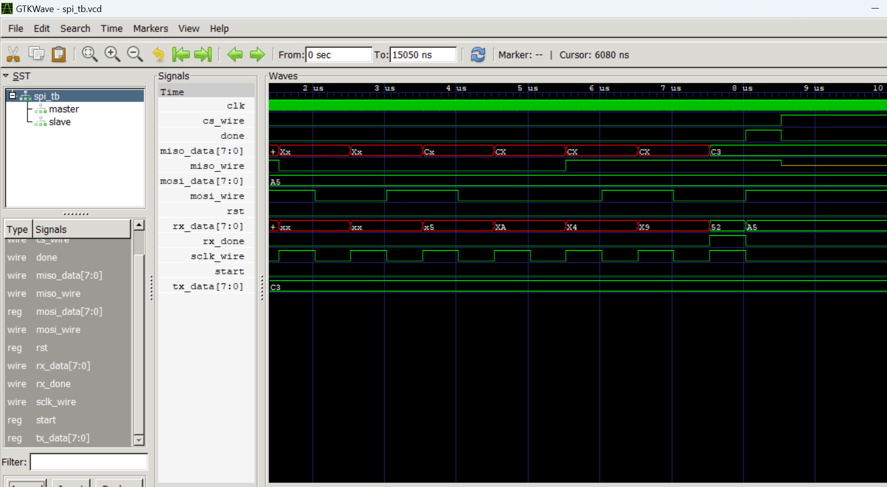

# SPI Master & Slave / Maître & Esclave SPI

## Description (EN)

SPI (Serial Peripheral Interface) is a synchronous serial communication protocol. Synchronous means that the master and slave share a common clock signal generated by the master. The master is responsible for generating the clock (SCLK) and the chip select signal (CS), which activates the slave. Both devices exchange data simultaneously — the master sends data via MOSI while the slave responds via MISO. SPI supports 4 configuration modes defined by CPOL and CPHA, which determine the clock polarity at rest and the moment data is sampled. This implementation uses Mode 0 (CPOL=0, CPHA=0) — clock idle low, data sampled on rising edge.

## Description (FR)

Le SPI (Serial Peripheral Interface) est un protocole de communication série synchrone. Synchrone signifie que le maître et l'esclave partagent une horloge commune générée par le maître. Le maître est responsable de la génération de l'horloge (SCLK) et du signal de sélection (CS) qui active l'esclave. Les deux échangent des données simultanément — le maître envoie via MOSI tandis que l'esclave répond via MISO. Le SPI supporte 4 modes de configuration définis par CPOL et CPHA, qui déterminent la polarité de l'horloge au repos et le moment où la donnée est échantillonnée. Cette implémentation utilise le Mode 0 (CPOL=0, CPHA=0) — horloge au repos à 0, données échantillonnées sur front montant.

## SPI Frame / Trame SPI

|CS | 1111 0000000000000000 1111|
|-----|---------------------------|
|SCLK | 0000 0101010101010101 0000|
|-----|-----------------------------|
|MOSI | xxxx D7 D6 D5 D4 D3 D2 D1 D0|
|-----|-----------------------------|
|MISO | xxxx D7 D6 D5 D4 D3 D2 D1 D0|


## Parameters / Paramètres

| Parameter | Value | Description |
|-----------|-------|-------------|
| CLKS_PER_HALF_BIT | 25 | System clock cycles per half SCLK period |

## Signals — Master / Signaux Maître

| Signal | Direction | Description |
|--------|-----------|-------------|
| clk | input | System clock |
| rst | input | Asynchronous reset |
| start | input | Starts the SPI transaction |
| mosi_data | input | 8-bit data to send to the slave |
| miso | input | Serial data received from the slave |
| sclk | output | SPI clock generated by the master |
| cs | output | Chip select — active low |
| mosi | output | Serial data sent to the slave |
| miso_data | output | 8-bit data received from the slave |
| done | output | Transaction complete signal |

## Signals — Slave / Signaux Esclave

| Signal | Direction | Description |
|--------|-----------|-------------|
| sclk | input | SPI clock from master |
| cs | input | Chip select — active low |
| mosi | input | Serial data received from master |
| tx_data | input | 8-bit data to send to the master |
| miso | output | Serial data sent to the master |
| rx_data | output | 8-bit data received from the master |
| rx_done | output | Reception complete signal |

## SPI Modes / Modes SPI

| Mode | CPOL | CPHA | Description |
|------|------|------|-------------|
| 0 | 0 | 0 | Clock idle low, sample on rising edge |
| 1 | 0 | 1 | Clock idle low, sample on falling edge |
| 2 | 1 | 0 | Clock idle high, sample on falling edge |
| 3 | 1 | 1 | Clock idle high, sample on rising edge |

## How to simulate / Comment simuler

```bash
iverilog -g2012 -o spi_tb.vvp src/spi_master.sv src/spi_slave.sv tb/spi_tb.sv
vvp spi_tb.vvp
```

## Waveform / Formes d'onde


## Author / Auteur
LIADI Ramadan Atanda