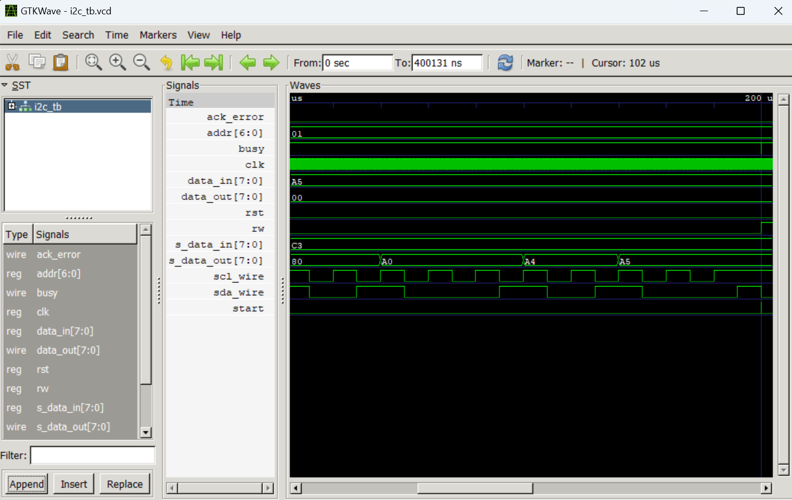
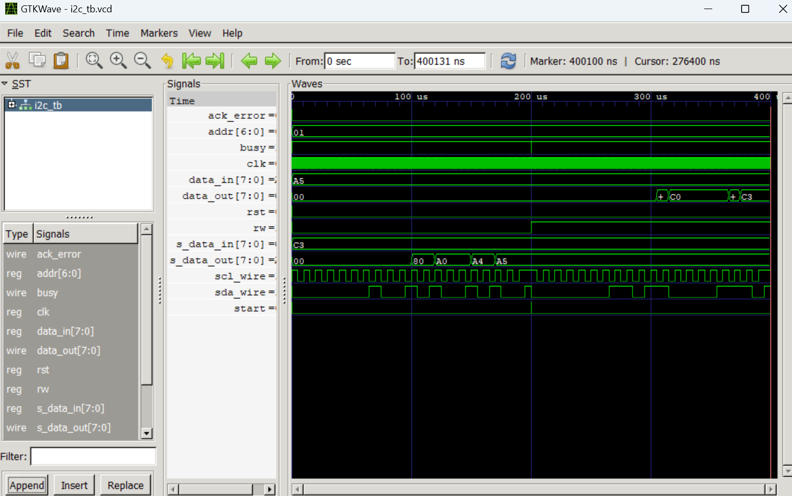

# I²C Master & Slave / Maître & Esclave I²C

## Description (EN)

This project implements an I²C master and slave using SystemVerilog. The master sends the slave address, selects the transfer direction and transmits or receives one byte of data. The slave checks the received address, acknowledges valid requests and handles data transmission or reception. A testbench is used to simulate write and read operations with Icarus Verilog, and the waveforms can be viewed using GTKWave.

## Description (FR)

Ce projet consiste à concevoir un maître et un esclave I²C en SystemVerilog. Le maître transmet l’adresse de l’esclave, définit le sens du transfert et envoie ou reçoit un octet de données. L’esclave vérifie l’adresse reçue, acquitte les requêtes valides et gère la transmission ou la réception des données. Un testbench permet de simuler les opérations de lecture et d’écriture avec Icarus Verilog, et les chronogrammes peuvent être visualisés avec GTKWave.

## I²C Frame / Trame I²C

START | ADDR(7bits) | R/W | ACK | DATA(8bits) | ACK/NACK | STOP  
↓ ↓ ↓ ↓ ↓ ↓ ↓  
SDA SDA SDA SDA SDA SDA SDA

## Parameters / Paramètres

| Parameter | Value | Description |
|-----------|-------|-------------|
| CLK_PER_HALF_BIT | 250 | Number of master clock cycles per half-period of SCL / Nombre de cycles d’horloge du maître par demi-période de SCL |

## Master Signals / Signaux Maître

| Signal | Direction | Description |
|--------|-----------|-------------|
| clk | input | Master system clock / Horloge du système |
| rst | input | Asynchronous active-high reset / Réinitialisation asynchrone active à l’état haut |
| start | input | Starts a new I²C transaction / Lance une nouvelle transaction I²C |
| rw | input | Transfer direction: 0 = write, 1 = read / Sens du transfert : 0 = écriture, 1 = lecture |
| addr | input | 7-bit slave address / Adresse de l’esclave sur 7 bits |
| data_in | input | Byte to transmit to the slave / Octet à transmettre à l’esclave |
| sda | inout | Bidirectional serial data bus / Bus de données série bidirectionnel |
| scl | output | Serial clock generated by the master / Horloge série générée par le maître |
| busy | output | Indicates whether a transaction is in progress / Indique si une transaction est en cours |
| ack_error | output | Indicates a missing acknowledgement / Signale l’absence d’un acquittement |
| data_out | output | Byte received by the master during a read / Octet reçu par le maître lors d’une lecture |

## Slave Signals / Signaux Esclave

| Signal | Direction | Description |
|--------|-----------|-------------|
| scl | input | Clock generated by the master / Horloge générée par le maître |
| rst | input | Asynchronous active-high reset / Réinitialisation asynchrone active à l’état haut |
| rw | input | Retained for interface compatibility; the transfer direction is decoded from SDA / Conservé pour la compatibilité ; le sens du transfert est décodé depuis SDA |
| sda | inout | Bidirectional serial data bus / Bus de données série bidirectionnel |
| s_data_in | input | Byte sent by the slave to the master during a read / Octet envoyé par l’esclave au maître lors d’une lecture |
| s_data_out | output | Byte received by the slave during a write / Octet reçu par l’esclave lors d’une écriture |

## FSM States / États FSM

### Master

| State | Description |
|-------|-------------|
| IDLE | Waits for a start request / Attend une demande de démarrage |
| START | Generates the START condition / Génère la condition START |
| ADDR_LOW | Sends an address or R/W bit while SCL is low / Transmet un bit d’adresse ou R/W lorsque SCL est bas |
| ADDR_HIGH | Maintains the address bit while SCL is high / Maintient le bit d’adresse lorsque SCL est haut |
| ACK_ADDR_LOW | Releases SDA for the slave acknowledgement / Relâche SDA pour l’acquittement de l’esclave |
| ACK_ADDR_HIGH | Checks the acknowledgement of the address / Vérifie l’acquittement de l’adresse |
| DATA_LOW | Prepares a data bit or releases SDA for reading / Prépare un bit de données ou relâche SDA en lecture |
| DATA_HIGH | Transmits or samples a data bit / Transmet ou échantillonne un bit de données |
| ACK_DATA_LOW | Prepares the acknowledgement clock pulse / Prépare l’impulsion d’horloge d’acquittement |
| ACK_DATA_HIGH | Checks the slave acknowledgement during a write / Vérifie l’acquittement de l’esclave lors d’une écriture |
| STOP_LOW | Holds SDA low while SCL is low / Maintient SDA à l’état bas lorsque SCL est bas |
| STOP_HIGH | Raises SCL while SDA remains low / Remonte SCL en maintenant SDA à l’état bas |
| STOP_END | Releases SDA to generate the STOP condition / Relâche SDA pour générer la condition STOP |

### Slave

| State | Description |
|-------|-------------|
| IDLE | Starts receiving the slave address / Commence la réception de l’adresse de l’esclave |
| ADDR | Receives the remaining address bits and the R/W bit / Reçoit les bits restants de l’adresse et le bit R/W |
| ACK_ADDR | Acknowledges a matching slave address / Acquitte une adresse esclave correspondante |
| NACK_ADDR | Does not acknowledge an incorrect address / N’acquitte pas une adresse incorrecte |
| DATA_RX | Receives one byte from the master / Reçoit un octet du maître |
| ACK_DATA | Acknowledges the received data byte / Acquitte l’octet de données reçu |
| DATA_TX | Transmits one byte to the master / Transmet un octet au maître |
| WAIT_NACK | Waits for the master's response after a read / Attend la réponse du maître après une lecture |
| WAIT_STOP | Waits for the end of the transaction / Attend la fin de la transaction |

## How to simulate / Comment simuler

```bash
iverilog -g2012 -o i2c_tb.vvp src/i2c_master.sv src/i2c_slave.sv tb/i2c_tb.sv
vvp i2c_tb.vvp
```

## Waveform / Formes d'onde

  


## Author / Auteur

LIADI Ramadan Atanda
